# Manual de Uso para Recepción en Celular
**Módulo de Acreditación y Registro de Asistencia**  
*Congreso de Logística y Transporte UNaB 2026*

---

## 📱 ¿Cómo funciona la Acreditación desde el Celular?

El día del evento, el personal de recepción utilizará sus teléfonos móviles para registrar y acreditar a cada participante en segundos.

El sistema identifica automáticamente el rol de la persona (**Asistente General**, **Representante de Empresa** o **Disertante**), valida sus datos para el certificado oficial y emite la confirmación en pantalla.

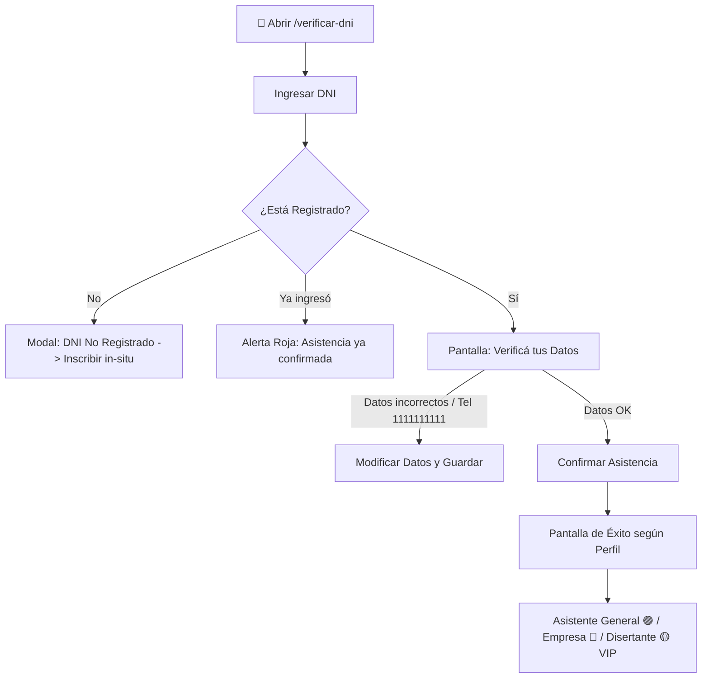

---

## 🚀 Flujo Rápido en 3 Pasos Simples

### Paso 1: Ingresar el DNI del Participante

1. Al abrir el sistema en el celular (`/verificar-dni`), verás la pantalla de bienvenida.
2. Pedí el DNI al participante y escribilo en el casillero **(solo números, sin puntos ni espacios)**.
3. Tocá el botón violeta **"Ingresar a Acreditación"**.

  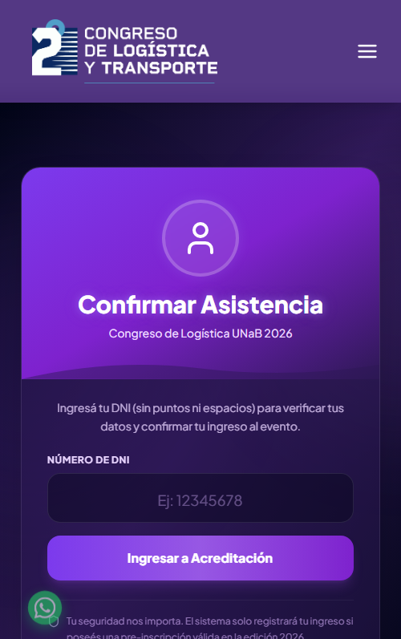

---

### Paso 2: Verificar los Datos Personales

Aparecerá la pantalla **"Verificá tus Datos"**. 

> ⚠️ **Muy Importante:** Preguntale al asistente si su **Nombre, Apellido y Email** están bien escritos. Tal como figuren aquí, se emitirá su **Certificado Digital Oficial**.

  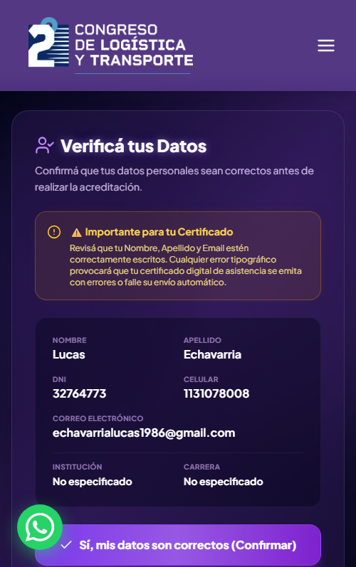

* **Si todos los datos son correctos:** Tocá el botón violeta:  
  **`✓ Sí, mis datos son correctos (Confirmar)`**.
* **Si hay algún error (letras cambiadas, email viejo, carrera):** Tocá el botón:  
  **`Modificar Datos`** (ver Paso 3).

---

### Paso 3: Corrección Rápida de Datos (Opcional)

Si el participante necesita corregir su nombre, email o teléfono:

1. Modificá el campo que corresponda directamente desde el teclado del celular.
2. Tocá **`✓ Guardar y Acreditar`**.  
El sistema guarda los cambios y confirma la asistencia en el mismo instante.

  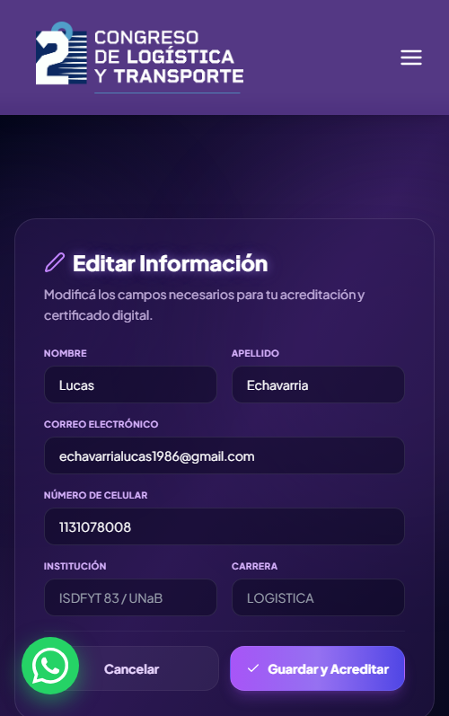

---

## 👥 Perfiles de Participantes: ¿Qué Pantalla Debe Aparecer?

Al confirmar, aparecerá una **Pantalla de Éxito a pantalla completa**. El color y el texto indican qué tipo de credencial o kit corresponde entregar:

---

### 1. Asistente General (Estudiantes, Docentes, Profesionales)
*Es el caso más frecuente (90% de los asistentes).*

* **Color:** **Violeta Institucional UNaB**.
* **Badge:** `ASISTENTE GENERAL`.
* **Acción de Recepción:**
  * Entregar pulsera / credencial general.
  * Informar que el certificado le llegará automáticamente a su correo electrónico.
  * Indicar acceso libre a las salas del congreso.

  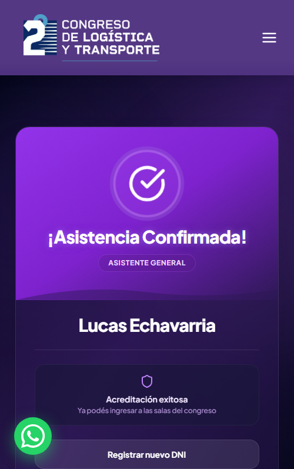

---

### 2. Representante de Empresa (Sponsors y Stands)
*Para delegados y representantes de empresas que apoyan el evento.*

* **Color:** **Azul Eléctrico / Corporativo**.
* **Ícono:** Edificio (`Building2`).
* **Badge:** `REPRESENTANTE DE EMPRESA`.
* **Dato adicional:** Muestra debajo el nombre de la firma (por ejemplo, *Representante de Aeronova*).
* **Acción de Recepción:**
  * Entregar credencial especial de empresa / expositor.
  * Indicar la ubicación del stand o sector corporativo si corresponde.

  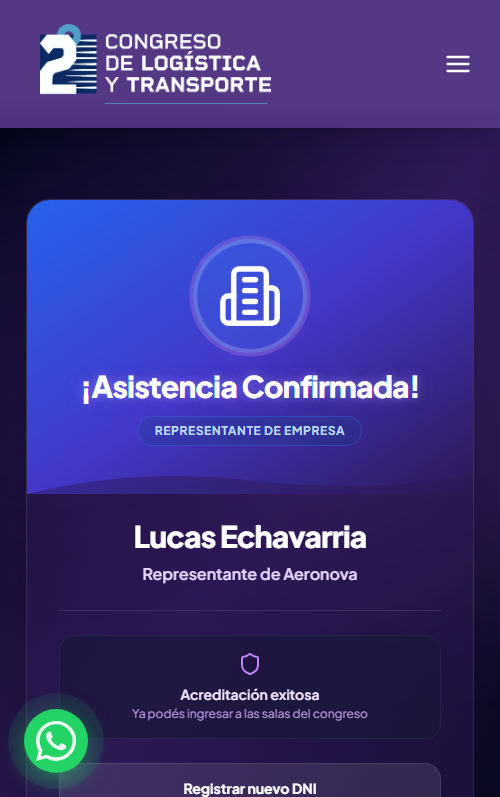

---

### 3. Disertante (Conferencistas, Panelistas y Speakers)
*Acceso VIP para oradores del congreso.*

* **Color:** **Dorado / Ámbar VIP**.
* **Ícono:** Micrófono de conferencia (`Mic2`).
* **Badge:** `DISERTANTE`.
* **Dato adicional:** Muestra el texto *"Disertante del Congreso"*.
* **Acción de Recepción:**
  * Entregar Credencial VIP de Disertante y Kit de Bienvenida.
  * Avisar al coordinador de auditorio o acompañarlo a la sala de oradores.

  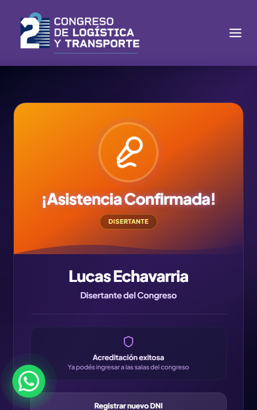

---

## ⚠️ Casos Especiales y Soluciones Rápidas

### Caso A: "La asistencia ya fue confirmada" (Alerta Roja)
* **Qué significa:** Ese DNI ya fue acreditado antes en la recepción.
* **Qué muestra la pantalla:** Un recuadro rojo con la fecha y hora exacta del ingreso previo.
* **Qué hacer:**
  * Si la persona ya ingresó antes y salió a tomar aire o almorzar, verificá que tenga su credencial o pulsera y permitile el reingreso.
  * Si dice que nunca ingresó, solicitá su DNI físico para corroborar su identidad.

  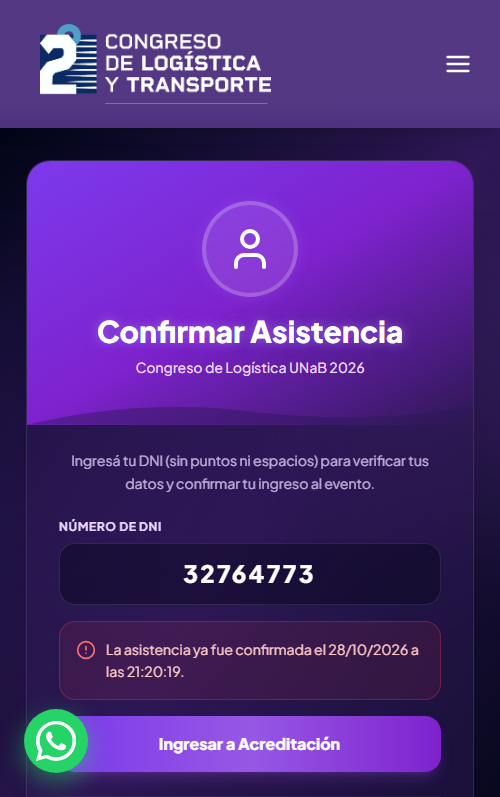

---

### Caso B: "Celular Provisional Detectado" (Alerta Rosa)
* **Qué significa:** El asistente fue pre-inscripto con el teléfono de prueba `'1111111111'`.
* **Qué muestra la pantalla:** Una alerta destacada informando el celular de prueba y bloqueando el botón de confirmación directa.
* **Qué hacer:**
  1. Tocá el botón **`Modificar Datos`**.
  2. Pedile su número de celular real (10 dígitos).
  3. Tocá **`Guardar y Acreditar`**.

  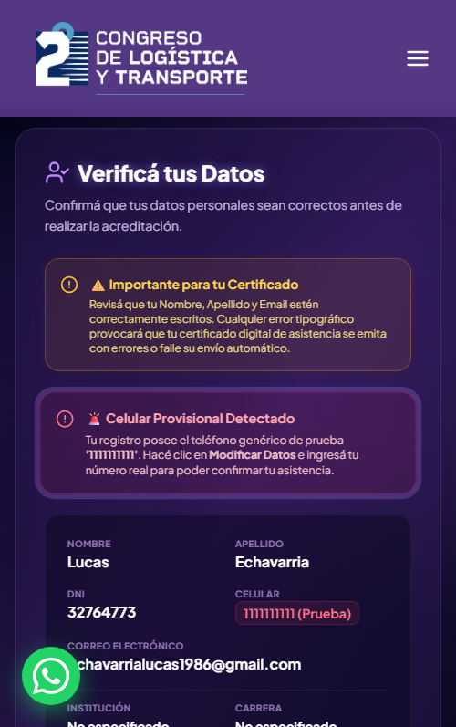

---

### Caso C: "DNI no registrado" (Persona sin inscripción previa)
* **Qué significa:** La persona fue directamente al evento sin registrarse antes en la web.
* **Qué muestra la pantalla:** Una ventana emergente con el botón **"Inscribirse ahora"**.
* **Qué hacer:**
  1. Tocá **"Inscribirse ahora"**.
  2. El celular abrirá el panel de selección de registro.
  3. Elegí la opción correspondiente (por ejemplo, *Inscribite como Visitante*) y completá los datos en 1 minuto.

  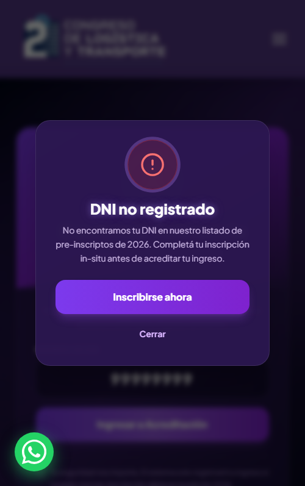
  &nbsp;&nbsp;&nbsp;
  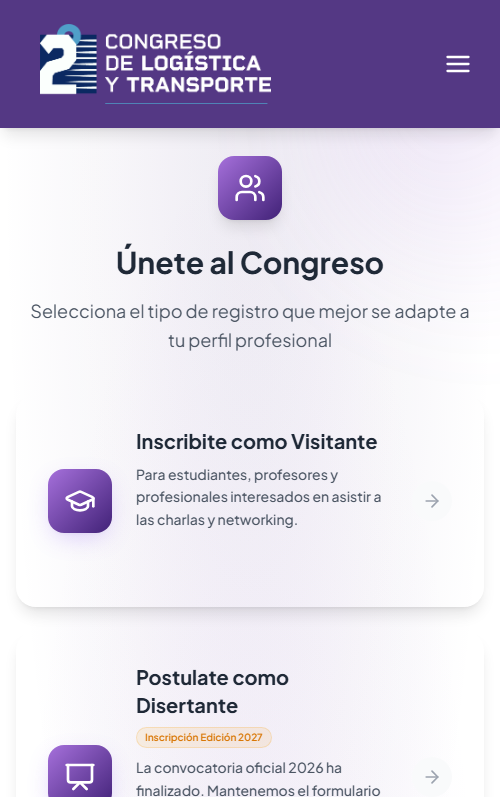

---

## 📋 Machete de Bolsillo para Recepcionistas

| Si en la pantalla ves... | Significa... | Qué hacés... |
| :--- | :--- | :--- |
| 🟣 **Badge Violeta "ASISTENTE GENERAL"** | Asistente general confirmado | Entregar credencial/pulsera estándar. |
| 🔵 **Badge Azul "REPRESENTANTE DE EMPRESA"** | Empresa / Expositor | Entregar credencial de empresa y ubicar su stand. |
| 🟡 **Badge Dorado/Ámbar con Micrófono "DISERTANTE"** | Conferencista / Panelista VIP | Entregar kit VIP y avisar al encargado de sala. |
| 🔴 **Recuadro Rojo "Asistencia ya confirmada"** | Ya ingresó antes | Verificar credencial física y permitir reingreso. |
| 🚨 **Recuadro Rosa "Celular Provisional"** | Teléfono de prueba 1111111111 | Tocar "Modificar Datos", poner celular real y guardar. |
| ⚠️ **Modal "DNI no registrado"** | No está anotado | Tocar "Inscribirse ahora" y registrarlo en el momento. |

---

*Manual de Operaciones para Dispositivos Móviles — Recepción y Acreditación Congreso UNaB 2026.*
